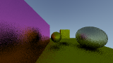
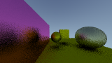

# Rust-RayTracer

A Rust CPU ray tracer that grew from static images into an animated C++/raylib window. It explores how a small set of geometric and material rules can produce an image, then how to keep displaying that image while the scene changes. Gravity-inspired ray bending, partial-frame updates, and temporal sampling are experiments along that path.

The latest implementation connects the renderer to a live display and keeps temporal averages at a stable brightness. This is still an unfinished rendering experiment, with useful geometry, material, and display components; it is not a finished engine or a validated physical simulation.

## The idea and how it developed

The February–March 2025 history shows a concrete progression:

1. **Construct an image from rays.** Early commits introduce vector arithmetic, a sky gradient, sphere intersections, a world containing multiple objects, cubes, reflections, and multiple samples per pixel. These pieces remain recognizable in the current modules.
2. **Make surfaces behave differently.** Diffuse scattering and fuzzy metal reflections turn the geometry into a material experiment. A ray can bounce recursively, carrying a surface's color into the result.
3. **Explore bent light paths.** The gravity commits experiment with redirecting rays near a mass rather than treating every path as one straight line. Commit messages describe black-hole renders, but the present equations should be understood as a visual experiment, not evidence of a general-relativistic solution.
4. **Move from completed images to a running window.** The later work adds an RGBA buffer, a C interface, and C++ window code. Commits progress from opening a window after rendering to displaying live frames and animated geometry.
5. **Trade rendering work against motion and noise.** Commit `cd2c672` updates one phase of a 3×3 pixel grid per frame, retaining the other pixels. The final 2025 renderer commit, `d6a987b` (“temporal sampling almost works”), replaces that selection with new samples for every pixel and an exponential moving average across frames.

That progression explains the mixed-language layout: Rust owns the scene and ray calculations, while C++ supplies the window and texture presentation. The central unfinished question is whether repeated, inexpensive samples can produce a stable moving image. Headless brightness and reproducibility measurements are recorded below; display frame rate and live motion quality remain unmeasured.

## The active rendering path

```text
C++ window loop
  → animate the first sphere
  → request a Rust image update
      → generate camera rays for each pixel in parallel
      → intersect the scene and scatter through materials
      → average this frame's samples
      → blend with the pixel's previous color
  → read Rust's RGBA buffer
  → update and draw a raylib texture
```

[`raytracer/src/main.rs`](raytracer/src/main.rs) contains the scene, rendering constants, recursive `ray_color`, parallel image update, and exported C functions. The scene is built directly in Rust: two spheres and three boxes, including a broad ground box. There is no scene-file loader or editor.

[`camera.rs`](raytracer/src/camera.rs) constructs a fixed camera and viewport. Each pixel receives randomized sample positions. The default render is 1080×607 with five samples per pixel per update and a maximum scattering depth of three. The window accepts dimensions, sample budget and a seed; the camera follows the selected aspect ratio. Each pixel/frame has an independent seeded random stream, so Rayon scheduling does not change the result. The previous unbounded frame-dependent camera jitter offset has been removed.

[`hittable_list.rs`](raytracer/src/hittable_list.rs) checks the scene's objects and retains the nearest hit. [`sphere.rs`](raytracer/src/sphere.rs) solves the sphere intersection; [`cube.rs`](raytracer/src/cube.rs) intersects axis-aligned boxes. [`material.rs`](raytracer/src/material.rs) separates geometry from scattering behavior: Lambertian surfaces scatter around the normal, while metals reflect with a configurable random fuzz. A miss produces the sky gradient.

Rayon distributes pixel updates across CPU workers. Raylib/OpenGL presents the resulting texture; it does not perform this ray tracing on the GPU. The current frame loop samples **every pixel**. The earlier interleaved-grid optimization is historical, not an additional active optimization in that 2025 implementation.

## Temporal accumulation and brightness

[`color_accumulator.rs`](raytracer/src/color_accumulator.rs) separates two types: `ColorAccumulator` stores a sum and divides by its sample count at display time; `EmaColorAccumulator` stores an exponential moving average (EMA) and displays that average directly. The renderer uses the EMA with `ALPHA = 0.5`:

```text
stored_color = alpha × new_frame_color + (1 − alpha) × stored_color
```

This keeps recent samples influential instead of weighting all past frames equally. It is a plausible mechanism for smoothing sampling noise while a scene moves, although motion-related artifacts have not been evaluated here.

The first frame initializes the EMA directly, without blending it with black. Later frames follow the formula above. The original implementation divided this already-averaged color by the frame count again, making a constant white input darken from 255 on frame 1 to 127 on frame 2 and 2 on frame 100. The separate types prevent that double normalization and keep the sum-based behavior available without mixing the two representations.

Regression tests cover unchanged white and colored inputs across 1,000 updates, first-frame initialization, weighted history, weights of zero and one, empty accumulators, and sum-based averaging. These checks establish the accumulator's arithmetic, not the full window's rendering quality or its motion behavior.

The capitalized [`ColorAccumulator.rs`](raytracer/src/ColorAccumulator.rs) is an older, separate file. The `mod color_accumulator` declaration selects the lowercase file described above. Editing the older file would not change the active renderer.

## Rust/C++ boundary and display

[`raytracer_ffi.h`](raytracer/src/raytracer_ffi.h) declares the C interface and matching four-byte RGBA pixel layout. Rust initializes and owns the image and accumulation buffers. C++ requests an update, then reads the pixel pointer to upload a texture. The pointer is not an ownership transfer to C++.

The active executable is [`raytracer/src/main.cpp`](raytracer/src/main.cpp). It initializes the buffers, opens a window at twice the render dimensions, optionally animates the first sphere, and repeatedly updates the texture. `SetTargetFPS(60)` is a requested display rate, not a demonstrated rendering speed. The crate is a shared library only; `cargo run` is not the route to this window.

A mutex-owned renderer contains the scene, camera and buffers. Rendering borrows each buffer once, replacing the previous overlapping mutable access through global statics. Animation safely replaces the known first scene object instead of casting a trait-object pointer to a sphere. It uses an absolute sine position with amplitude 0.05, so repeated calls do not integrate an unbounded, frame-rate-dependent displacement. The window advances animation by 1/60 simulated second per rendered frame. The C ABI remains a single-caller interface; its lifetime contract is below.

## Other experiments in the tree

| Path or feature | Relationship to the current renderer |
| --- | --- |
| Gravity branch in `ray_color` | Steps the ray through short segments and bends its direction using an inverse-square acceleration. `SINGULARITY` is currently `false`, so the default scene uses straight rays. |
| [`volumetric.rs`](raytracer/src/volumetric.rs) | Medium/scattering experiment; its module and imports are commented out in the active Rust entry point. |
| [`raytracer/cpp/main.cpp`](raytracer/cpp/main.cpp) | Earlier display experiment with an older interface. The active makefile does not build it. |
| [`raytracer/cpp/vulkanTest/`](raytracer/cpp/vulkanTest/) | Separate Vulkan/GLFW application and compute shader. The shader contains sphere-intersection code, but its scene traversal and scattering loop remain placeholders. It is not a GPU backend selected by the Rust renderer. |

Finishing the CPU renderer does not require completing these separate experiments. Their code and history preserve the directions explored without making them part of the current build path.

## Build and run

The verified source build is Linux, Rust/Cargo 1.94.0, GNU g++ 16.2.1,
GNU Make 4.4.1 and raylib 6.0.0 (GLFW desktop/OpenGL backend). Install Rust/Cargo,
a C++17 compiler, Make, pkg-config, raylib development headers/libraries and its
OpenGL/display dependencies through your platform's normal package manager.
`pkg-config --modversion raylib` must succeed. No system installation is performed
by this repository's Makefile. Other platforms/toolchain combinations are untested.

The crate now commits `Cargo.lock`, and all build recipes use `--locked`.
Unused `cgmath`, `rusty-ppm` and `lazy_static` declarations were removed; the
active Rust dependencies are `rand` and `rayon`. The lockfile records the exact
resolved dependencies (rand 0.9.4 and rayon 1.11.0 in this verification).
The first Cargo build needs registry access unless the locked crates are cached.

From the repository root:

```sh
make -f raytracer/src/makefile all
raytracer/target/release/raytracer-window --static --width 320 --height 180 --samples 5
# Animate; omit --static. Escape or close the window to exit.
raytracer/target/release/raytracer-window --width 320 --height 180 --samples 5
# Bounded, seeded capture on a working desktop:
mkdir -p outputs
raytracer/target/release/raytracer-window --static --width 320 --height 180 \
  --samples 5 --seed 42 --frames 100 --output outputs/static.ppm \
  --screenshot outputs/window.png
```

Build output goes under `raytracer/target/release`; historical checked-in binaries
are not used or overwritten. The window and `libraytracer.so` live together and
use `$ORIGIN` as the runtime library path. They can launch from a different
working directory. Raylib itself must remain available through the system loader.
`make -f /absolute/path/to/raytracer/src/makefile all` also works outside the repo.
The Makefile tracks Rust sources, Cargo files, the C++ source and FFI header.

Dimensions must be 2–4096, with at most 4,194,304 pixels; samples must be 1–1024.
The default is still 1080×607, five samples and seed 1. `--frames N` exits after
N updates; without it the window runs until closed. The image export is the Rust
buffer; the optional screenshot captures the actual window. Invalid options fail
with exit code 2. Read `--help` for the full option list.

## Offline checks and example frames

```sh
make -f raytracer/src/makefile test
python3 raytracer/tests/render_headless.py --output outputs/static.ppm
python3 raytracer/tests/render_headless.py --animated --output outputs/animated.ppm
```

The test target runs **11 Rust tests**, including the original eight accumulator
regressions unchanged, plus a separately compiled C++ FFI check. New checks cover
finite pre-conversion samples, identical bytes with one and four Rayon workers,
100-frame static brightness, repeatable absolute animation, initialization,
repeated updates, stable borrowed pointers, rejected invalid reinitialization,
successful reinitialization, opaque RGBA layout and idempotent shutdown. The Python
headless examples use only the standard library and the actual release library.

Both example frames below were rendered at **160×90, five samples per pixel,
100 updates, seed 42, depth three and EMA alpha 0.5**. They are headless renderer
outputs, not screenshots of a running window.

| Static | Animated at update 100 |
| --- | --- |
|  |  |

The mean RGB byte value across frames 6–15 versus 91–100 was **83.591 → 83.590**
for the static scene and **83.603 → 83.655** for the animated scene. This is a
coarse brightness check, not an image-quality metric or proof of convergence.
The static final RGB SHA-256 was
`5074a6db2708b10d694d94636f675a15d1c050e8f630c9492b530bf6de221deb`.
Same-seed replay and worker-count independence were tested on this build;
byte identity across different architectures or compiler versions is not promised.

The frames were visually inspected: spheres, boxes and the ground are visible,
and substantial grain remains on rough reflective surfaces. EMA retains recent
history, so moving edges can smear; live motion artifacts have not been evaluated.
This renderer has no denoiser, convergence criterion or physically validated
sampling/material model. Gravity, volumetrics and Vulkan remain outside this demo.

**Graphical limitation:** the C++ window compiled and loaded its Rust library from
`/tmp`, but actual startup returned exit code 1 because GLFW could not open X11
display `:0`. No static or animated window session, screenshot, sustained display
brightness or interactive shutdown is claimed. The source startup checks and
headless shutdown were exercised; a graphical session is still needed for the
remaining display review. Compiler/Clippy warnings remain in the experimental
modules; full-repository formatting cleanup is outside this change.

## FFI lifecycle

The ABI is declared in [`raytracer_ffi.h`](raytracer/src/raytracer_ffi.h).

1. Call `initialize_image()` for defaults, or
   `initialize_image_with_options(width, height, samples, seed)` and require return 1.
2. Optionally animate, call `update_image(frame)`, then read exactly
   `get_image_width() * get_image_height()` four-byte RGBA pixels.
3. Upload the borrowed bytes; do not free them or pass them to raylib `UnloadImage`.
4. Call `shutdown_image()` after the final read/upload. Repeated shutdown is safe.

The pointer remains stable during updates, and is invalidated by successful
reinitialization or shutdown. Invalid configuration returns 0 and preserves the
existing renderer. Before initialization and after shutdown, dimensions are zero,
the pointer is null, and updates/animation are no-ops. Reinitialization resets the
world, accumulation and animation clock. All calls and pointer reads must be
serialized by the caller; the mutex does not make unsynchronized raw-pointer
reads safe. The C++ window now frees its texture, closes the window and releases
the Rust renderer, without allocating the previously unused second texture.
